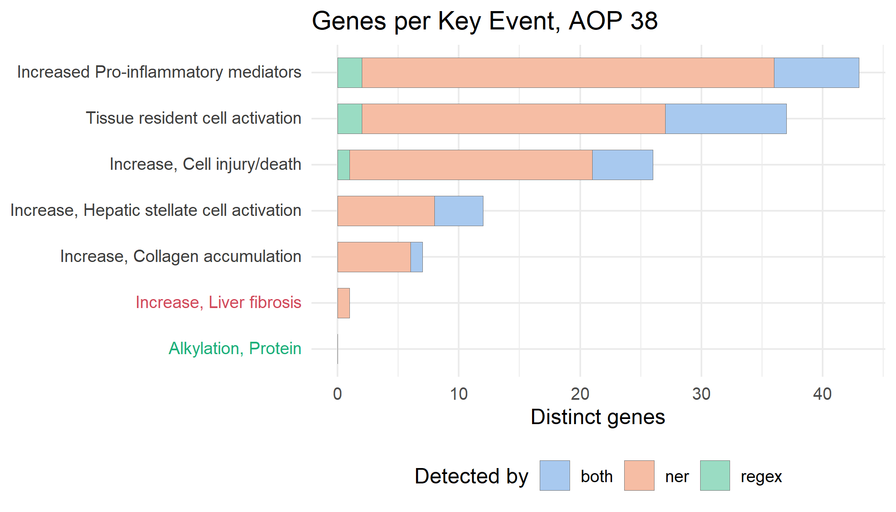
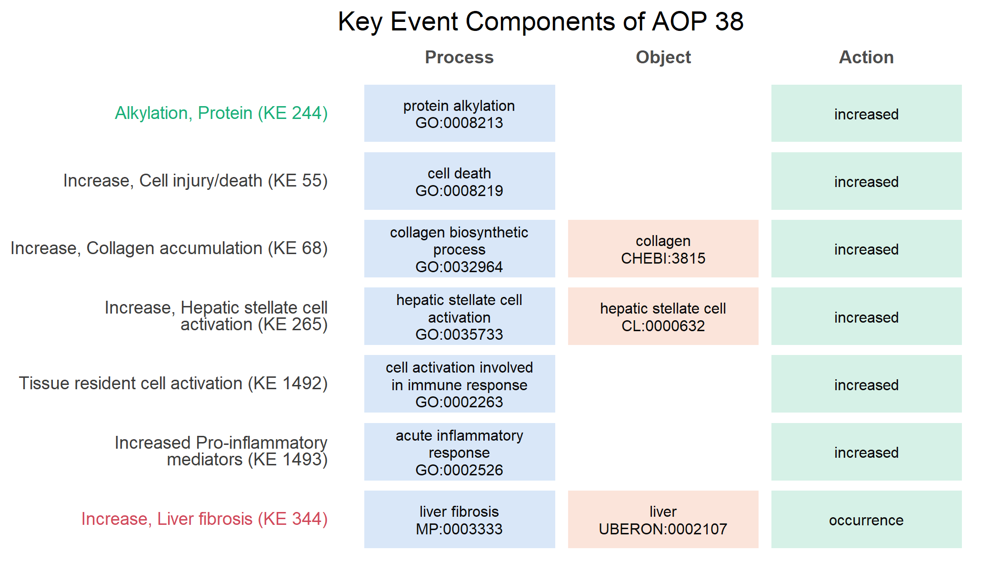

<!-- README.md is generated from README.Rmd. Please edit that file -->

# R4AOP

<!-- badges: start -->

[](https://github.com/SidraAdil/R4AOP/actions/workflows/R-CMD-check.yaml)
<!-- badges: end -->

R4AOP gives R users access to the [AOP-Wiki](https://aopwiki.org)
through its REST API. Adverse Outcome Pathways, Key Events, Key Event
Relationships, stressors, chemicals and genes are retrieved by calling a
function with arguments, and are returned as tibbles that fit straight
into an R workflow. The AOP-Wiki RDF data are normally queried with
SPARQL; for the routine tasks covered here, the package removes that
step.

## Installation

``` r
# install.packages("remotes")
remotes::install_github("SidraAdil/R4AOP")
```

## Example

Find the Adverse Outcome Pathways that describe liver fibrosis, then
follow one of them to its Key Events and genes.

``` r
library(R4AOP)

fibrosis <- aop_list(q = "liver fibrosis")
fibrosis[, c("id", "title", "oecd_status")]
#> # A tibble: 4 × 3
#>      id title                                                        oecd_status
#>   <int> <chr>                                                        <chr>      
#> 1    38 Protein Alkylation leading to Liver Fibrosis                 WPHA/WNT E…
#> 2   144 Endocytic lysosomal uptake leading to liver fibrosis         Under Revi…
#> 3   383 Inhibition of Angiotensin-converting enzyme 2 leading to li… Under Deve…
#> 4   494 AhR activation leading to liver fibrosis                     <NA>
```

``` r
kes <- aop_key_events(38)
kes[, c("id", "title", "role")]
#> # A tibble: 7 × 3
#>      id title                                      role 
#>   <int> <chr>                                      <chr>
#> 1    55 Increase, Cell injury/death                ke   
#> 2    68 Increase, Collagen accumulation            ke   
#> 3   244 Alkylation, Protein                        mie  
#> 4   265 Increase, Hepatic stellate cell activation ke   
#> 5   344 Increase, Liver fibrosis                   ao   
#> 6  1492 Tissue resident cell activation            ke   
#> 7  1493 Increased Pro-inflammatory mediators       ke
```

``` r
genes <- aop_genes(38)
nrow(genes)
#> [1] 245
table(genes$detected_by)
#> 
#>  both   ner regex 
#>    52   184     9
```

Genes are linked to individual Key Events, so each Key Event can be
treated as a candidate gene set. Key Event titles are printed in green
for the molecular initiating event and in red for the adverse outcome,
and Key Events without gene links are left out:

``` r
aop_plot_genes(38)
```



Key Events are also described in ontology terms, as a biological
process, an optional biological object and an action. Blank cells mark
components that AOP-Wiki does not record:

``` r
aop_plot_components(38)
```



## Main functions

| Topic | Functions |
|----|----|
| AOPs | `aop_list()`, `aop_get()`, `aop_key_events()`, `aop_kers()`, `aop_stressors()`, `aop_chemicals()`, `aop_genes()`, `aop_methods()` |
| Key Events | `ke_list()`, `mie_list()`, `ao_list()`, `ke_get()`, `ke_aops()`, `ke_upstream()`, `ke_downstream()`, `ke_mies()`, `ke_adverse_outcomes()`, `ke_stressors()`, `ke_chemicals()` |
| Relationships | `ker_list()`, `ker_get()` |
| Stressors and chemicals | `stressor_list()`, `stressor_get()`, `chemical_list()`, `chemical_get()`, `chemical_aops()`, `chemical_key_events()`, `chemical_pathways()` |
| Genes and search | `gene_list()`, `gene_get()`, `aop_search()` |
| Key Event Components | `ke_components()`, `aop_components()`, `aop_plot_components()` |
| Summaries | `aop_gene_summary()`, `aop_plot_genes()` |
| Dataset | `aop_dataset_info()`, `aop_data_version()`, `aop_cache_clear()` |

Responses are cached for the session, and list endpoints are paginated
automatically, so a call such as `ke_list()` returns all Key Events
rather than the first page.

## Reproducibility

AOP-Wiki is curated continuously. Every result carries the version of
the data it came from, which can be reported alongside an analysis:

``` r
aop_data_version(fibrosis)
#> [1] "2026.09.19-103c6e9"
```

## Data source and licence

Data come from the [AOP-Wiki
RDF](https://aopwiki.rdf.bigcat-bioinformatics.org) API, maintained by
the Department of Translational Genomics (TGX) at Maastricht University,
and are licensed [CC BY-SA
4.0](https://creativecommons.org/licenses/by-sa/4.0/). The package code
is licensed GPL-3.

When using R4AOP, please cite both the package and AOP-Wiki.
