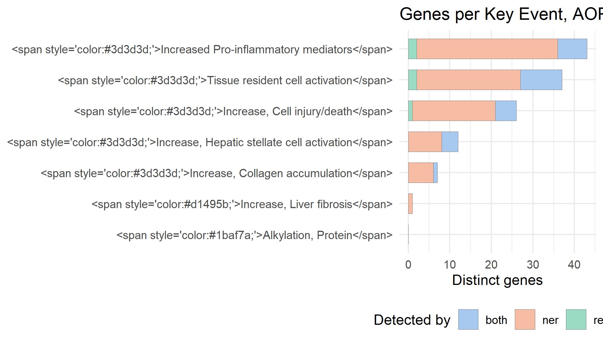
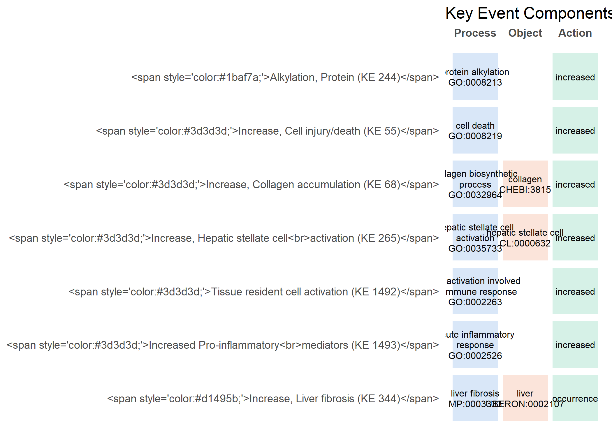

The output in this vignette was generated once against the dataset version
reported in the Reproducibility section, rather than at build time, because
every call queries the live AOP-Wiki API. The code is shown exactly as it ran.

AOP-Wiki is published as RDF and is normally queried with SPARQL. That is a
barrier for some people, and it means that questions which are conceptually
simple ("which genes belong to this Adverse Outcome Pathway (AOP)?") require a
query language.

This article answers one such question end to end, using only R4AOP functions.
The question is:

> What does AOP-Wiki store about liver fibrosis, and which genes are involved?


``` r
library(R4AOP)
library(ggplot2)
```

## 1. Find the relevant pathways

`aop_list()` retrieves AOPs and accepts a free-text filter, which searches the
AOP title and short name.


``` r
fibrosis <- aop_list(q = "liver fibrosis")
fibrosis[, c("id", "title", "oecd_status")]
#> # A tibble: 4 × 3
#>      id title                                          oecd_status
#>   <int> <chr>                                          <chr>      
#> 1    38 Protein Alkylation leading to Liver Fibrosis   WPHA/WNT E…
#> 2   144 Endocytic lysosomal uptake leading to liver f… Under Revi…
#> 3   383 Inhibition of Angiotensin-converting enzyme 2… Under Deve…
#> 4   494 AhR activation leading to liver fibrosis       <NA>
```

The result is an ordinary tibble, so the returned set can be narrowed by any
column, according to the context of the question. Development stage, last
modification date, or the identifiers of the events a pathway contains are all
available:


``` r
# by development stage
fibrosis[which(fibrosis$oecd_status == "WPHA/WNT Endorsed"), c("id", "title")]
#> # A tibble: 1 × 2
#>      id title                                       
#>   <int> <chr>                                       
#> 1    38 Protein Alkylation leading to Liver Fibrosis

# by recency of curation
fibrosis[fibrosis$modified > "2023-01-01", c("id", "title", "modified")]
#> # A tibble: 4 × 3
#>      id title                                             modified
#>   <int> <chr>                                             <chr>   
#> 1    38 Protein Alkylation leading to Liver Fibrosis      2025-10…
#> 2   144 Endocytic lysosomal uptake leading to liver fibr… 2023-04…
#> 3   383 Inhibition of Angiotensin-converting enzyme 2 le… 2023-04…
#> 4   494 AhR activation leading to liver fibrosis          2026-08…
```

AOPs are living documents: most are still under development and are revised as
evidence accumulates, so no single column defines a "correct" subset. Which
filter is appropriate depends on the question being asked. Here we continue with
OECD endorsed AOP:


``` r
aop_id <- 38
aop_id
#> [1] 38
```

The `mie_ids` and `ao_ids` columns hold identifiers rather than text. Setting
`resolve_titles = TRUE` looks those up, so the start and end points of each
pathway can be read directly:


``` r
titled <- aop_list(q = "liver fibrosis", resolve_titles = TRUE)

data.frame(
  id  = titled$id,
  mie = vapply(titled$mie_titles, function(x) paste(x, collapse = "; "), ""),
  ao  = vapply(titled$ao_titles,  function(x) paste(x, collapse = "; "), "")
)
#>    id                           mie                       ao
#> 1  38           Alkylation, Protein Increase, Liver fibrosis
#> 2 144  Endocytotic lysosomal uptake Increase, Liver fibrosis
#> 3 383 Induced dysregulation of ACE2 Increase, Liver fibrosis
#> 4 494               Activation, AhR Increase, Liver fibrosis
```

## 2. Inspect the structure of the pathway

A single AOP record gives the descriptive metadata.


``` r
aop <- aop_get(aop_id)
aop$title
#> [1] "Protein Alkylation leading to Liver Fibrosis"
aop$oecd_status
#> [1] "WPHA/WNT Endorsed"
```

Its Key Events (KEs) are the biological steps of the pathway. The `role` column
marks where each event is positioned in the cause-and-effect chain: `mie` is the
molecular initiating event (MIE), `ao` the adverse outcome (AO), and `ke`
everything in between.


``` r
kes <- aop_key_events(aop_id)
kes[, c("id", "title", "role")]
#> # A tibble: 7 × 3
#>      id title                                      role 
#>   <int> <chr>                                      <chr>
#> 1    55 Increase, Cell injury/death                ke   
#> 2    68 Increase, Collagen accumulation            ke   
#> 3   244 Alkylation, Protein                        mie  
#> 4   265 Increase, Hepatic stellate cell activation ke   
#> 5   344 Increase, Liver fibrosis                   ao   
#> 6  1492 Tissue resident cell activation            ke   
#> 7  1493 Increased Pro-inflammatory mediators       ke
```


``` r
table(kes$role)
#> 
#>  ao  ke mie 
#>   1   5   1
```

The Key Event Relationships (KERs) are the directed links between those steps.
Each KER carries the upstream (cause) and downstream (effect) KE.


``` r
kers <- aop_kers(aop_id)

edges <- data.frame(
  ker_id = kers$id,
  from   = kers$upstream$title,
  to     = kers$downstream$title
)
edges
#>   ker_id                                       from
#> 1     68                Increase, Cell injury/death
#> 2     82            Increase, Collagen accumulation
#> 3    269                        Alkylation, Protein
#> 4    295 Increase, Hepatic stellate cell activation
#> 5   1718                Increase, Cell injury/death
#> 6   1763            Tissue resident cell activation
#> 7   1764       Increased Pro-inflammatory mediators
#>                                           to
#> 1 Increase, Hepatic stellate cell activation
#> 2                   Increase, Liver fibrosis
#> 3                Increase, Cell injury/death
#> 4            Increase, Collagen accumulation
#> 5            Tissue resident cell activation
#> 6       Increased Pro-inflammatory mediators
#> 7 Increase, Hepatic stellate cell activation
```

Read together, `kes` and `edges` are the full topology of the pathway: nodes and
directed edges. Everything needed to build a graph object or a diagram is
already here, in two calls.

## 3. Retrieve the linked genes

AOP-Wiki genes come from the enriched RDF layer, which links genes to KEs and to
KERs. The `detected_by` column records how the link
was made: `regex` for pattern matching, `ner` for named entity recognition, and
`both` where the two methods agree.


``` r
genes <- aop_genes(aop_id)
nrow(genes)
#> [1] 245
head(genes)
#> # A tibble: 6 × 5
#>   hgnc_id symbol entity_type entity_id detected_by
#>     <int> <chr>  <chr>           <int> <chr>      
#> 1     129 ACTA1  ker               295 ner        
#> 2     270 PARP1  key_event          55 ner        
#> 3     333 AGT    key_event         265 both       
#> 4     352 AIF1   key_event        1492 ner        
#> 5     352 AIF1   ker              1718 ner        
#> 6     391 AKT1   ker               295 ner
```


``` r
table(genes$detected_by)
#> 
#>  both   ner regex 
#>    54   182     9
```

The `detected_by` column lets the three groups be compared directly.


``` r
per_method <- aggregate(symbol ~ detected_by, data = genes,
                        FUN = function(x) length(unique(x)))
names(per_method)[2] <- "n_genes"
per_method
#>   detected_by n_genes
#> 1        both      40
#> 2         ner     124
#> 3       regex       7
```

## 4. Genes per Key Event

Gene links are attached to individual KEs, not only to the AOP as a whole, so
each KE can be treated as a candidate gene set. This is what makes the data
usable in a transcriptomics analysis.

`aop_gene_summary()` returns those counts, and `aop_plot_genes()` draws them:


``` r
summary_tbl <- aop_gene_summary(aop_id)
summary_tbl
#> # A tibble: 14 × 5
#>    ke_id ke_title                        role  detected_by n_genes
#>    <int> <chr>                           <chr> <chr>         <int>
#>  1    55 Increase, Cell injury/death     ke    both              5
#>  2    55 Increase, Cell injury/death     ke    ner              20
#>  3    55 Increase, Cell injury/death     ke    regex             1
#>  4    68 Increase, Collagen accumulation ke    both              1
#>  5    68 Increase, Collagen accumulation ke    ner               6
#>  6   265 Increase, Hepatic stellate cel… ke    both              4
#>  7   265 Increase, Hepatic stellate cel… ke    ner               8
#>  8   344 Increase, Liver fibrosis        ao    ner               1
#>  9  1492 Tissue resident cell activation ke    both             10
#> 10  1492 Tissue resident cell activation ke    ner              25
#> 11  1492 Tissue resident cell activation ke    regex             2
#> 12  1493 Increased Pro-inflammatory med… ke    both              7
#> 13  1493 Increased Pro-inflammatory med… ke    ner              34
#> 14  1493 Increased Pro-inflammatory med… ke    regex             2
```


``` r
aop_plot_genes(aop_id)
```



Six of the seven KEs carry gene links. The MIE of this AOP carries none, and it
is drawn with an empty bar, so the gap in the annotation stays visible.

The plot is an ordinary ggplot object, so it can be adjusted like any other,
for example with a different theme or colour scale.

A gene set for one KE, ready for enrichment analysis, is one line:


``` r
mie_id <- kes$id[kes$role == "mie"]
mie_genes <- unique(genes$symbol[genes$entity_id == mie_id])
length(mie_genes)
#> [1] 0
head(mie_genes, 10)
#> character(0)
```

## 5. Key Event Components

KEs are also described by Key Event Components (KECs), each a triplet of a
biological process (BP), a biological object (BO), and an action term. The BP and
the BO are ontology terms, and the action gives the directionality aspect of the KE.
Each KE has one or more KECs. Not all KEs in AOP-Wiki are fully described this
way, so the BP or the BO can be empty. The BP and BO terms carry identifiers from
a range of ontologies.


``` r
aop_components(aop_id)[, c("ke_id", "process", "process_id", "action")]
#> # A tibble: 7 × 4
#>   ke_id process                                  process_id action
#>   <int> <chr>                                    <chr>      <chr> 
#> 1    55 cell death                               GO:0008219 incre…
#> 2    68 collagen biosynthetic process            GO:0032964 incre…
#> 3   244 protein alkylation                       GO:0008213 incre…
#> 4   265 hepatic stellate cell activation         GO:0035733 incre…
#> 5   344 liver fibrosis                           MP:0003333 occur…
#> 6  1492 cell activation involved in immune resp… GO:0002263 incre…
#> 7  1493 acute inflammatory response              GO:0002526 incre…
```


``` r
aop_plot_components(aop_id)
```



Blank cells are informative in their own right: they show where the ontology
annotation of a pathway is still incomplete.

## 6. Other questions about the same pathway

The same pathway can be approached from several directions, each a single call.

What is known to trigger it:


``` r
aop_stressors(aop_id)[, c("id", "title")]
#> # A tibble: 5 × 2
#>      id title               
#>   <int> <chr>               
#> 1     9 Allyl Alcohol       
#> 2    13 Carbon tetrachloride
#> 3    18 Dimethyl nitrosamine
#> 4    60 Retinol             
#> 5    63 Thioacetamide
aop_chemicals(aop_id)
#> # A tibble: 5 × 4
#>   cas      title                  inchikey             stressor_id
#>   <chr>    <chr>                  <chr>                      <int>
#> 1 107-18-6 Allyl alcohol          XXROGKLTLUQVRX-UHFF…           9
#> 2 56-23-5  Carbon tetrachloride   VZGDMQKNWNREIO-UHFF…          13
#> 3 62-75-9  N-Nitrosodimethylamine UMFJAHHVKNCGLG-UHFF…          18
#> 4 68-26-8  Retinol                FPIPGXGPPPQFEQ-OVSJ…          60
#> 5 62-55-5  Thioacetamide          YUKQRDCYNOVPGJ-UHFF…          63
```

Whether a particular gene belongs to this AOP, and how the link was made:


``` r
"TGFB1" %in% genes$symbol
#> [1] TRUE
genes[genes$symbol == "TGFB1", ]
#> # A tibble: 7 × 5
#>   hgnc_id symbol entity_type entity_id detected_by
#>     <int> <chr>  <chr>           <int> <chr>      
#> 1   11766 TGFB1  key_event         265 ner        
#> 2   11766 TGFB1  key_event        1493 ner        
#> 3   11766 TGFB1  ker                68 ner        
#> 4   11766 TGFB1  ker               295 ner        
#> 5   11766 TGFB1  ker              1718 ner        
#> 6   11766 TGFB1  ker              1763 ner        
#> 7   11766 TGFB1  ker              1764 ner
```

KEs can be filtered by gene, and each KE reports the AOPs it belongs to:


``` r
kes_with_gene <- ke_list(gene = "TGFB1")
nrow(kes_with_gene)
#> [1] 17

aops_with_gene <- unique(unlist(
  lapply(head(kes_with_gene$id, 5), function(i) ke_aops(i)$id)
))
aops_with_gene
#>  [1]  21  57 131 150 151 310 414 415 416 417 418 419 420 439 455
#> [16] 456 458 459 494 563 577 578  27 303 377 412 638  43 624 625
#> [31] 626 627 628 629  38 144
```

## 7. Reproducibility

AOP-Wiki is curated continuously, so results depend on the version of the data
that was queried. Every R4AOP result carries that version, and it can be
reported alongside the findings.


``` r
aop_data_version(fibrosis)
#> [1] "2026.10.31-ca48500"
```

## 8. What this replaces

Retrieving the same information directly from the RDF endpoint means one SPARQL
query per step: declaring prefixes, matching the AOP to its KEs through
`aopo:has_key_event`, following `aopo:has_key_event_relationship` for the
topology, and joining the enriched gene links. Each query has to be written
against the RDF schema and kept in step with it, in every project that needs it.

With R4AOP each of those steps is a single function call. The package covers the
routine tasks that most analyses begin with: listing AOPs, filtering them,
following the links to KEs, KERs, stressors, chemicals and genes, and pulling the
results into tibbles that fit directly into an R workflow. These are the steps that are repeated in nearly every
project, and they are the ones the package makes immediate. SPARQL stays
available for tailored or complex retrieval that no endpoint covers.

# Session information


``` r
sessionInfo()
#> R version 4.6.2 (2026-10-29 ucrt)
#> Platform: x86_64-w64-mingw32/x64
#> Running under: Windows 11 x64 (build 22631)
#> 
#> Matrix products: default
#>   LAPACK version 3.12.1
#> 
#> locale:
#> [1] LC_COLLATE=English_Netherlands.utf8 
#> [2] LC_CTYPE=English_Netherlands.utf8   
#> [3] LC_MONETARY=English_Netherlands.utf8
#> [4] LC_NUMERIC=C                        
#> [5] LC_TIME=English_Netherlands.utf8    
#> 
#> time zone: Europe/Amsterdam
#> tzcode source: internal
#> 
#> attached base packages:
#> [1] stats     graphics  grDevices utils     datasets  methods  
#> [7] base     
#> 
#> other attached packages:
#> [1] ggplot2_4.0.3  R4AOP_0.99.0   testthat_3.3.2
#> 
#> loaded via a namespace (and not attached):
#>  [1] KEGGREST_1.53.6      gtable_0.3.6        
#>  [3] xfun_0.62            httr2_1.3.0         
#>  [5] devtools_2.5.2       Biobase_2.73.2      
#>  [7] vctrs_0.7.3          tools_4.6.2         
#>  [9] generics_0.1.4       stats4_4.6.2        
#> [11] curl_8.1.0           tibble_3.3.1        
#> [13] AnnotationDbi_1.75.2 RSQLite_3.53.3      
#> [15] blob_1.3.0           pkgconfig_2.0.3     
#> [17] BiocBaseUtils_1.15.1 RColorBrewer_1.1-3  
#> [19] S7_0.2.2             desc_1.4.3          
#> [21] S4Vectors_0.51.10    graph_1.91.0        
#> [23] lifecycle_1.0.5      compiler_4.6.2      
#> [25] farver_2.1.2         Biostrings_2.81.9   
#> [27] brio_1.1.5           Seqinfo_1.3.2       
#> [29] usethis_3.2.2        pillar_1.11.1       
#> [31] crayon_1.5.3         ellipsis_0.3.3      
#> [33] cachem_1.1.0         sessioninfo_1.2.4   
#> [35] tidyselect_1.2.1     dplyr_1.2.1         
#> [37] purrr_1.2.2          labeling_0.4.3      
#> [39] rprojroot_2.1.1      fastmap_1.2.0       
#> [41] grid_4.6.2           cli_3.6.6           
#> [43] magrittr_2.0.5       XML_3.99-0.25       
#> [45] pkgbuild_1.4.8       utf8_1.2.6          
#> [47] GSEABase_1.75.0      withr_3.0.3         
#> [49] scales_1.4.0         bit64_4.8.6         
#> [51] XVector_0.53.0       httr_1.4.9          
#> [53] bit_4.6.0            otel_0.2.0          
#> [55] ggtext_0.2.0         png_0.1-9           
#> [57] memoise_2.0.1        evaluate_1.0.5      
#> [59] knitr_1.52           IRanges_2.47.5      
#> [61] rlang_1.3.0          Rcpp_1.1.2          
#> [63] gridtext_0.1.6       xtable_1.8-8        
#> [65] glue_1.8.1           DBI_1.3.0           
#> [67] xml2_1.6.0           BiocGenerics_0.59.12
#> [69] pkgload_1.5.3        rstudioapi_0.19.0   
#> [71] annotate_1.91.0      jsonlite_2.0.0      
#> [73] R6_2.6.1             fs_2.1.0
```
